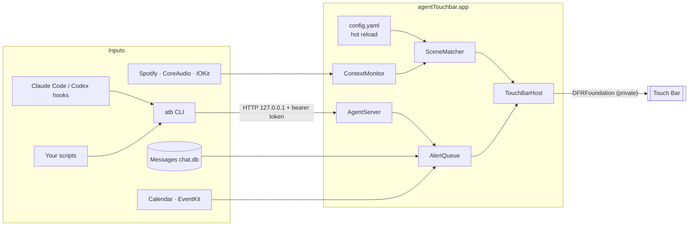

# agentTouchbar

[](https://github.com/Qiao527/agent-touchbar/actions/workflows/build.yml)


[](LICENSE)

**Turn the MacBook Pro Touch Bar into a context-aware "dynamic island."** It stays quiet until something needs you (an SMS verification code, Claude Code asking for permission, a meeting starting in five minutes), lets you handle it with one tap, and changes its controls with what you are doing.

English | [简体中文](README.zh-CN.md)

<!-- TODO: replace with a recording from real hardware -->
> 📹 Demo GIF coming soon: the project has not been run on Touch Bar hardware yet (see [Status](#status)).

## Why

Most people with a Touch Bar MacBook ignore it: the default controls duplicate the keyboard, and it never tells you anything. But it is a color display that sits right above your hands. agentTouchbar uses it for the small interruptions of a workday:

- **Approve AI agents without switching windows.** When Claude Code or Codex asks to run `rm -rf build`, the Touch Bar shows the command with **Allow** and **Deny**.
- **Paste 2FA codes in one tap.** Codes forwarded from your iPhone to Messages appear on the Touch Bar; tap to paste into the focused field.
- **Never miss the start of a meeting.** Five minutes before an event, a **Join** button appears; during the call you get mute, camera, and leave controls.

## Features

| | |
|---|---|
| **Alerts** (appear only when needed) | Verification codes · Claude Code / Codex finished or waiting · permission requests with Allow / Deny · meeting in N minutes · download finished · low battery · low AirPods battery · Pomodoro, water, and stand-up reminders |
| **Scenes** (switch automatically) | Meeting: mute, camera, leave, timer · Coding: agent status, git branch, command buttons · Browser: video scrubber, speed, skip intro, tabs, page summary · Music: Spotify artwork and controls |
| **One-tap actions** | Clipboard history · snippets (secrets in Keychain) · audio output switching · dark mode, Do Not Disturb, screenshot, lock · AI translate / polish / explain for selected text |
| **Status** | Clock with multiple time zones · weather · battery · CPU and memory · next event countdown |
| **Extensible** | Script widgets (any script that prints JSON) · `atb notify` from your own tools · YAML config with hot reload · English and Simplified Chinese UI |

## How it works



- **AgentTouchbarCore** holds all logic that can be tested without a Mac: config parsing, scene matching, the alert queue, verification-code extraction, hook parsing, HTTP parsing, and localization. CI runs its tests on Linux and macOS.
- **atb** is a small CLI that Claude Code and Codex call as a hook. For permission requests it long-polls the app and prints the hook's decision JSON. It always exits 0, so a missing app never breaks your agent.
- **AgentTouchbar.app** is a menu bar app. `TouchBar/DFR.swift` is the only file that calls private APIs, and it resolves them with `dlsym`, so a macOS update degrades the app instead of crashing it.

See [docs/DESIGN.md](docs/DESIGN.md) for the full design.

## Install

Requirements: a MacBook Pro with Touch Bar and Apple silicon (13-inch M1 or M2), macOS 14 or later.

**From source** (needs `xcode-select --install`):

```bash
git clone https://github.com/Qiao527/agent-touchbar.git
cd agent-touchbar
./scripts/install.sh
```

**Prebuilt:** download the zip from [Releases](https://github.com/Qiao527/agent-touchbar/releases) once the first version is tagged (until then, every CI run uploads one as an artifact). The build is not notarized, so clear the quarantine flag before opening it:

```bash
xattr -dr com.apple.quarantine agentTouchbar.app
mv agentTouchbar.app /Applications/ && open /Applications/agentTouchbar.app
```

### First run

1. Click the menu bar icon and choose **Send test alert** to confirm the Touch Bar works.
2. Choose **Copy Claude Code hooks config** and paste it into `~/.claude/settings.json`; do the same for Codex in `~/.codex/config.toml` and run `/hooks` in Codex to trust them.
3. Grant permissions when the menu asks:

| Permission | Needed for |
|---|---|
| Full Disk Access | Reading verification codes from Messages (enable Text Message Forwarding on your iPhone) |
| Accessibility | Pasting codes and snippets, meeting shortcuts, reading selected text |
| Calendar | Next event and meeting alerts |
| Automation | Spotify, browser video, dark mode (macOS prompts on first use) |

## Configuration

Everything lives in `~/.config/agentTouchbar/config.yaml`, created on first launch and reloaded on save. If a change has an error, the app keeps the last good config and shows where the error is. Full example: [config/config.example.yaml](config/config.example.yaml).

```yaml
layout:
  left: [esc]
  island: [next_event, now_playing, pomodoro]
  right: [weather, clock, battery, volume]

scenes:
  - name: Coding
    when:
      app: [iTerm2, Visual Studio Code, Cursor]
    island: [agents, git_branch, dev]

widgets:
  - id: dev
    type: buttons
    items:
      - { title: Test, icon: "sf:checkmark.seal", run: "cd ~/code/app && npm test", notify: true }
      - { title: Deploy, icon: "sf:paperplane", run: "./deploy.sh", confirm: true }
```

Send alerts from anything:

```bash
atb notify --title "Build finished" --detail "3m 12s" --icon sf:hammer --color green --ttl 20
```

Or turn any script into a widget by printing one line of JSON:

```json
{ "text": "BTC 68,210", "icon": "sf:bitcoinsign.circle", "color": "orange", "progress": 0.4 }
```

## Engineering notes

A few problems that shaped the design:

- **Displaying over every app.** The public `NSTouchBar` API only works while your app is frontmost. Global display uses `presentSystemModalTouchBar` from the private `DFRFoundation` framework, the same mechanism MTMR, Pock, and BetterTouchTool rely on. I checked recent reports for macOS 26 and 27 before committing to it, and wrote a [probe](probe/) that tests each API on the target machine.
- **Waking a dimmed Touch Bar.** The Touch Bar turns itself off after about a minute idle, which would defeat "show only when needed." The app escalates from re-presenting the bar, to the public `IOPMAssertionDeclareUserActivity`, to the private `DFRBrightnessClient` used by the system's own dimming, checking `DFRGetStatus` after each step.
- **Approving agent actions safely.** The permission hook blocks while the Touch Bar waits for a tap, so it has a hard timeout and falls back to the terminal prompt. A down app, a bad token, or malformed input all produce "no decision," never a failure.
- **Reading message bodies.** Recent macOS versions store SMS text in `attributedBody`, a serialized `NSAttributedString`, instead of the `text` column. The decoder extracts the string from the typedstream without a full unarchiver, and it is unit-tested with generated fixtures.
- **Testing without the hardware.** Everything except the AppKit layer is in a Foundation-only target, so 49 unit tests run on Linux in CI. A test also scans the sources and fails if any UI string lacks a translation.

## Status

| Area | State |
|---|---|
| Core logic, CLI | Implemented, unit-tested on Linux and macOS |
| Menu bar app, all widgets | Implemented, compiles in CI on macOS 26 |
| Behavior on real Touch Bar hardware | **Not verified yet**; run `probe/run.sh` first |
| Settings window | Not started; configuration is file-based |

## Roadmap

- [ ] Verify on hardware with the probe and record a demo
- [ ] System notification fallback when the Touch Bar cannot be woken
- [ ] Settings window with a drag-and-drop Touch Bar preview
- [ ] Notarized releases

## How this was built

I built this project with an AI coding agent (Kiro) as a pair programmer. I came up with the product, chose the features and their priorities, researched feasibility, and made the design and scope decisions; the agent wrote most of the implementation under that direction. [docs/DESIGN.md](docs/DESIGN.md) records the decisions and trade-offs.

## License

[MIT](LICENSE) © 2026 Qiao Long
