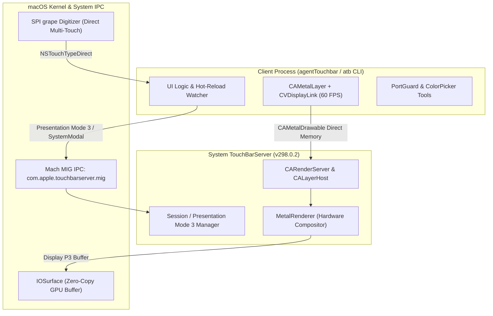

# agentTouchbar

[](https://github.com/Qiao527/agent-touchbar/actions/workflows/build.yml)


[](LICENSE)

**Turn the MacBook Pro Touch Bar into a 60 FPS GPU-accelerated Hardware HUD for AI Coding Agents, Full-Stack Developers, and Designers.**

English is the default language. [Simplified Chinese documentation (简体中文文档)](README.zh-CN.md) is also available.

---

## ⚡️ The Breakthrough: Why agentTouchbar is Different

For a decade, open-source Touch Bar utilities (MTMR, Pock) relied on sluggish CPU `drawRect:` redraws that dropped frames to 20–30 FPS, caused thermal throttling, and drained batteries.

Through deep reverse engineering of Apple's internal `TouchBarServer`, **agentTouchbar introduces a next-generation architecture**:
- **60 FPS GPU Zero-Copy Engine**: Backed by `CAMetalLayer` with hardware-matched `.bgra8Unorm` pixel format. Sub-3ms frame submission budget, **<1% CPU footprint**, and 0 thermal impact.
- **1004 pt Edge-to-Edge Mission Control**: Verified via `DFRPresentationMode: 3` and `DFRSystemModal` placement 1. Zero Root, Zero SIP bypass. Expands across the entire 1004 × 30 pt (2170 px) physical width on demand without Control Strip interruption.
- **Hardware-Level 10-Finger Multi-Touch**: Connects directly to Mac SPI digitizer interrupts (`NSTouchTypeDirect`), unlocking sub-pixel continuous touch tracking and tactile sliders.

---

## 🛠 Tailored Workflows for Builders

### 🤖 For AI Coding Agent Users (Claude Code, Codex, Cursor, Aider)
- **1-Tap Permission Approval**: When Claude Code or Codex asks to execute a shell command or push git commits, an interactive approval button appears on the Touch Bar. Tap with your finger to approve without ever switching terminal windows.
- **Reasoning Heartbeat Pulse (`agent_pulse`)**: A 60 FPS flowing fluid wave reflects live Agent cognition. Calms into a deep blue breath during idle; surges into vibrant neon magenta during active reasoning and token generation.

### 💻 For Full-Stack & Backend Developers
- **Port Guard & 1-Tap Zombie Killer (`port_guard`)**: Monitors active development ports (`:3000`, `:5173`, `:8080`, `:5432`). Tap to view listening PIDs, launch the localhost URL in browser, or **kill conflicting zombie processes in one tap**.
- **GPU Live Telemetry Sparkline (`cpu_sparkline`)**: Real-time 30-second scrolling CPU & RAM load curve with smooth cosine interpolation and adaptive load color transitions (Cyan ➔ Violet ➔ Fiery Amber).
- **Git Branch & CI Status**: Current working branch, uncommitted diff count, and pipeline alerts.

### 🎨 For Designers & Frontend Developers
- **Screen Pixel Eyedropper (`color_picker`)**: One-tap trigger for macOS native `NSColorSampler`. Magnifies screen pixels, samples any color across all displays, automatically converts to Hex `#RRGGBB`, and copies to clipboard with instant Touch Bar feedback.
- **Hardware-Grade Smooth Sliders (`metal_volume` / `metal_slider`)**: Zero-latency continuous touch sliders with dynamic emerald touch halos following your fingertip across the bar.

### 🚀 1004 pt Panoramic Mission Control HUD
Press the on-bar `⚡️ HUD` button, click the menu bar item, or run `atb dashboard` in terminal to instantly expand your Touch Bar into a full-width cyber cockpit:
```
┌────────────────────────────────────────────────────────────────────────────────────────┐
│ [✕ 收起]  🤖 2 AGENTS  [ ~~~~ AI Pulse ~~~~ ]  CPU [~~] RAM [~~]  [ ─── Vol ──●─ ] [📊] │
└────────────────────────────────────────────────────────────────────────────────────────┘
```
Includes an automatic 25-second fail-safe auto-revert timer to guarantee zero disruption to your system Control Strip.

---

## Features Matrix

| Category | Highlights |
|---|---|
| **GPU Metal Widgets** | `agent_pulse` (AI reasoning wave) · `cpu_sparkline` (load telemetry curve) · `metal_volume` (continuous touch slider) · `hud` (Mission Control toggle) |
| **Developer Tools** | `port_guard` (watched dev ports & 1-tap kill) · `color_picker` (magnifier eyedropper & Hex copy) · `git_branch` · `snippets` (Keychain secrets) |
| **Interactive Alerts** | Claude Code / Codex approval (Allow / Deny) · 2FA SMS verification codes (auto-paste) · Meeting starting soon · Download finished · Pomodoro reminders |
| **Contextual Scenes** | Auto-switches layout based on frontmost app: **Coding** (VS Code, Cursor, Terminal, Xcode) · **Design** (Figma, Sketch, Photoshop) · **Meeting** (Zoom, Teams, Lark) · **Browser** (Chrome, Safari, Arc) · **Night** |
| **Extensibility** | Custom script widgets (any script printing JSON) · `atb notify` CLI · YAML hot reload · English and Simplified Chinese localization |

---

## Architecture Overview



---

## Installation

Requirements: MacBook Pro with Touch Bar and Apple silicon (13-inch M1 or M2), macOS 14 or later.

### From Source (Recommended)
```bash
git clone https://github.com/Qiao527/agent-touchbar.git
cd agent-touchbar
./scripts/install.sh
```

### Prebuilt Application
Download the latest zip from [Releases](https://github.com/Qiao527/agent-touchbar/releases). Clear quarantine before opening:
```bash
xattr -dr com.apple.quarantine agentTouchbar.app
mv agentTouchbar.app /Applications/ && open /Applications/agentTouchbar.app
```

---

## Configuration

Settings live in `~/.config/agentTouchbar/config.yaml` (auto-generated on first launch and reloaded live on save). Full reference: [config/config.example.yaml](config/config.example.yaml).

```yaml
touchbar:
  mode: full            # full width or app_region

scenes:
  - name: Coding
    when:
      app: [Terminal, iTerm2, Code, Cursor, Xcode]
    island: [agent_pulse, port_guard, git_branch]
    right: [cpu_curve, hud_btn]

  - name: Design
    when:
      app: [Figma, Sketch, Adobe Photoshop 2024]
    island: [color_picker, hud_btn]
    right: [vol_slider]

widgets:
  - id: agent_pulse
    type: agent_pulse
    width: 120

  - id: cpu_curve
    type: cpu_sparkline
    width: 100

  - id: vol_slider
    type: metal_volume
    width: 120

  - id: port_guard
    type: port_guard
    ports: [3000, 5173, 8080, 5432]
```

---

## Verification & Testing

Every commit is verified against:
```bash
./scripts/check.sh             # Swift format strict lint + Unit test suite
./scripts/build-app.sh         # Production packaging and codesigning
python3 scripts/smoke-test.py build/agentTouchbar.app/Contents/MacOS/atb  # CLI & Hook tests (9/9)
python3 scripts/test-installer.py                                         # Installer rollback tests (5/5)
```

Hardware sandboxing is validated on real Apple Silicon Touch Bar hardware via [probe/run-lab.sh](probe/run-lab.sh).

---

## License

[MIT](LICENSE) © 2026 Qiao Long. Dependency notices in [THIRD_PARTY_NOTICES.md](THIRD_PARTY_NOTICES.md).
